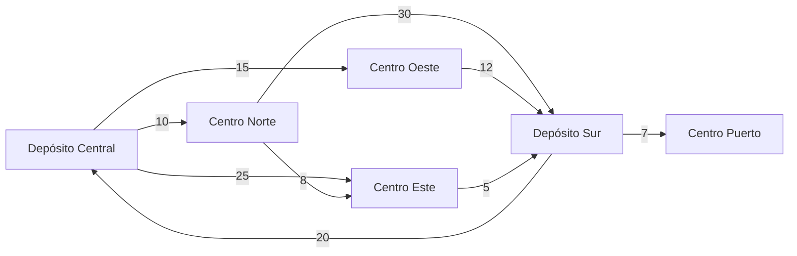
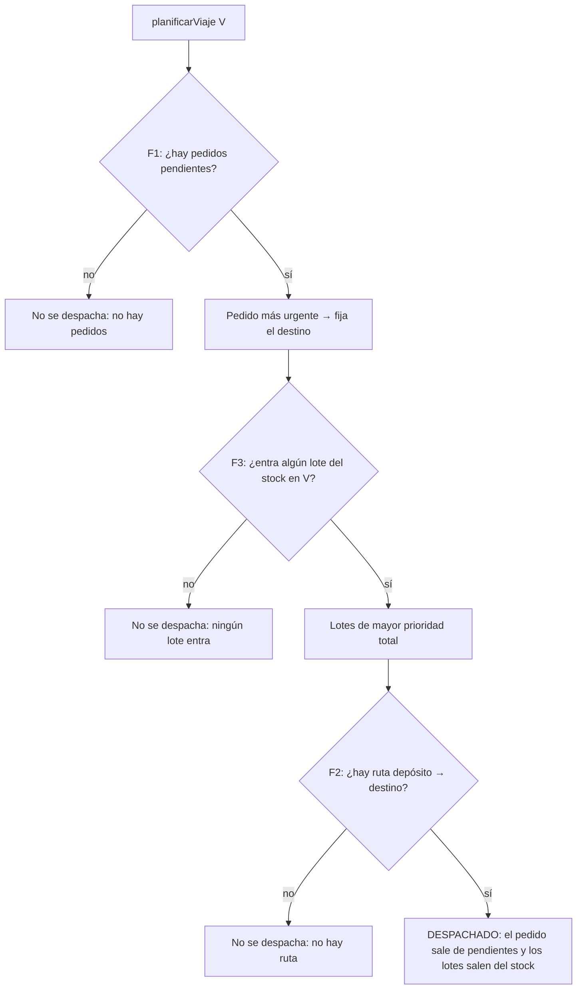

# TrabajoPractico-CocosTeam

El presente trabajo desarrolla la Propuesta 2, Planificación de rutas y distribución de ayuda. El caso de estudio es una organización que distribuye alimentos, medicamentos e insumos entre centros comunitarios y que necesita organizar sus pedidos, calcular recorridos y asignar sus recursos de manera eficiente.

Todo el desarrollo del proyecto está realizado en [Informe](https://docs.google.com/document/d/1A2bGTz5Wx8q8Sr30sbPmfmpjojKgeR5RfaQMMITpxZU/edit?tab=t.0). Mientras que las implementaciones en Java están en los directorios disponibles en este repositorio.

**Equipo (Cocos Team):** Alejo Guillen Lopez (1147173) · Nicolas Alcorta (1209397) · Lisandro Duclos (1155273)

---

## Índice

1. [Funcionalidades](#1-funcionalidades)
2. [Requisitos](#2-requisitos)
3. [Estructura del proyecto](#3-estructura-del-proyecto)
4. [Compilar y ejecutar](#4-compilar-y-ejecutar)
5. [Escenarios disponibles](#5-escenarios-disponibles)
6. [Datos de ejemplo cargados](#6-datos-de-ejemplo-cargados)
7. [Algoritmos utilizados](#7-algoritmos-utilizados)
8. [Integración de las funcionalidades](#8-integración-de-las-funcionalidades)
9. [Pruebas](#9-pruebas)
10. [Decisiones de diseño y restricciones](#10-decisiones-de-diseño-y-restricciones)
11. [Limitaciones y trabajo futuro](#11-limitaciones-y-trabajo-futuro)

---

## 1. Funcionalidades

| # | Funcionalidad | Técnica | Clases principales |
|---|---|---|---|
| F1 | Organización y consulta de pedidos: ordenar por fecha límite o por prioridad, y buscar un pedido por id | Divide y Conquista | `MergeSort`, `BusquedaBinaria` |
| F2 | Ruta más rápida entre dos ubicaciones de la red vial, con conexiones que se pueden deshabilitar | Greedy | `Dijkstra`, `MinHeap` |
| F3 | Selección de los lotes de mayor prioridad total que entran en un vehículo | Programación Dinámica | `SeleccionCargas` |
| Integración | Planificación de un viaje completo que encadena F1 → F3 → F2 | — | `SistemaLogistica`, `BitacoraViajes` |

---

## 2. Requisitos

- **JDK 11 o superior** (probado con JDK 21). El código usa `String.repeat`, `isBlank` y `stripLeading`, que no existen en Java 8.
- No hay dependencias externas, Maven ni Gradle: alcanza con `javac` y `java`.
- Opcional: VS Code con el *Extension Pack for Java* (el repo ya trae la configuración en `.vscode/settings.json`) o IntelliJ IDEA.

---

## 3. Estructura del proyecto

```
TrabajoPractico-CocosTeam/
├── docs/
│   └── integracion.md              Propuesta de integración discutida en el equipo
├── src/
│   ├── main/java/logistica/
│   │   ├── Main.java               Punto de entrada: corre todos los escenarios de demo
│   │   ├── modelo/                 Entidades del dominio
│   │   │   ├── Pedido.java         id, centro destino, fecha límite, prioridad, peso
│   │   │   ├── Lote.java           id, peso (kg), prioridad
│   │   │   ├── Vehiculo.java       id, capacidad (kg), depósito de salida
│   │   │   ├── RedVial.java        Grafo dirigido con listas de adyacencia
│   │   │   ├── Ubicacion.java      Nodo de la red (depósito o centro)
│   │   │   └── Conexion.java       Arista dirigida con tiempo (min) y estado habilitada
│   │   ├── algoritmos/
│   │   │   ├── dyc/                F1: MergeSort, BusquedaBinaria
│   │   │   ├── greedy/             F2: Dijkstra, MinHeap
│   │   │   ├── dinamica/           F3: SeleccionCargas (mochila 0/1)
│   │   │   └── backtracking/       Reservado para la segunda etapa (vacío)
│   │   ├── resultado/              Objetos que devuelven los algoritmos (con métricas)
│   │   │   ├── ResultadoOrdenamiento, ResultadoBusqueda   (F1)
│   │   │   ├── ResultadoRuta                              (F2)
│   │   │   ├── ResultadoCarga                             (F3)
│   │   │   └── ResultadoViaje                             (integración)
│   │   └── sistema/
│   │       ├── SistemaLogistica.java   Fachada: datos, validaciones y planificación de viajes
│   │       └── BitacoraViajes.java     Presentación por consola de los viajes
│   └── test/java/logistica/
│       ├── PruebasPedidos.java     F1
│       ├── PruebasRutas.java       F2
│       ├── PruebasCargas.java      F3
│       └── PruebasSistema.java     Integración
└── .vscode/settings.json           sourcePaths y carpeta de salida (out/)
```

---

## 4. Compilar y ejecutar

Todos los comandos se ejecutan **desde la carpeta `TrabajoPractico-CocosTeam/`**. La salida compilada va a `out/`, que está en el `.gitignore`.

### macOS / Linux

```bash
# Compilar todo (código y pruebas)
javac -encoding UTF-8 -d out $(find src -name "*.java")

# Ejecutar la demo con todos los escenarios
java -cp out logistica.Main

# Ejecutar las pruebas
java -cp out logistica.PruebasPedidos
java -cp out logistica.PruebasRutas
java -cp out logistica.PruebasCargas
java -cp out logistica.PruebasSistema
```

### Windows (cmd)

```bat
dir /s /b src\*.java > fuentes.txt
javac -encoding UTF-8 -d out @fuentes.txt
chcp 65001
java -cp out logistica.Main
```

`chcp 65001` pone la consola en UTF-8 para que se vean bien los acentos de la salida.

### Desde el IDE

- **VS Code:** abrir la carpeta `TrabajoPractico-CocosTeam/` y usar *Run* sobre `Main.java` o sobre cualquiera de las clases `Pruebas*.java`. Todas tienen su propio `main`.
- **IntelliJ IDEA:** marcar `src/main/java` como *Sources Root* y `src/test/java` como *Test Sources Root*, y ejecutar el `main` de la clase que se quiera.

### Ejecutar un solo escenario

`Main.main` corre las cuatro demos en orden:

```java
public static void main(String[] args) {
    demoPedidos();    // F1
    demoRutas();      // F2
    demoCargas();     // F3
    demoIntegrada();  // F1 -> F3 -> F2
}
```

Para ver sólo una, comentar las otras líneas en [`Main.java`](src/main/java/logistica/Main.java) y volver a compilar. Las demos no comparten estado: cada una arma sus propios datos, así que se pueden correr en cualquier combinación.

---

## 5. Escenarios disponibles

La demo (`logistica.Main`) recorre los escenarios de abajo. Los resultados esperados son los que da hoy el programa.

### 5.1 F1: Organización y consulta de pedidos (`demoPedidos`)

Usa los 10 pedidos de la [sección 6.1](#61-pedidos-de-la-demo-f1).

| Escenario | Qué se hace | Resultado esperado |
|---|---|---|
| Orden por fecha | `MergeSort.ordenar(pedidos, FECHA)` | De #101 (12/11) a #110 (30/11). #101 y #105 vencen el mismo día y gana el id menor. 23 comparaciones. |
| Orden por prioridad | `MergeSort.ordenar(pedidos, PRIORIDAD)` | Primero #104 y #107 (prioridad 5). Empatan en prioridad y gana #104, que vence antes. #102 y #109 empatan en prioridad y fecha, y gana el id menor. 25 comparaciones. |
| Búsqueda de un id existente | Se ordena por id y se busca el 108 | Encontrado en 2 pasos. |
| Búsqueda de un id inexistente | Se busca el 111 | No existe (4 pasos). |
| Traza de Merge Sort | Se ordenan 6 pedidos por prioridad con traza | Se muestra cada *Dividir* y cada *Mezclar* con los ids del tramo, indentados por nivel de recursión. |
| Traza de búsqueda binaria | Se busca el 109 (existe) y el 105 (no está entre los 6) | Se muestra cada intervalo `[ini, fin]` y el medio elegido hasta encontrarlo o quedar con un intervalo vacío. |

### 5.2 F2: Ruta más rápida (`demoRutas`)

Usa la red vial de la [sección 6.2](#62-red-vial-de-ejemplo-f2-e-integración).

| Escenario | Qué se hace | Resultado esperado |
|---|---|---|
| 1) Cálculo normal con traza | Depósito Central → Depósito Sur | **23 min** por Central → Norte → Este → Sur. La traza muestra cada nodo fijado y cada relajación. |
| 2) Sentido de circulación | Central → Norte y Norte → Central | Ida: **10 min** directo. Vuelta: **33 min** (Norte → Este → Sur → Central), porque no existe la conexión Norte → Central. |
| 3) Conexión deshabilitada | Se corta Centro Norte → Centro Este y se recalcula Central → Sur | **27 min** por Central → Oeste → Sur. La traza indica `deshabilitada, se ignora`. |
| 4) Destino inalcanzable | Central → Puerto antes y después de cortar Sur → Puerto | Antes: **34 min**. Después: *No existe una ruta disponible*, porque era la única conexión que llegaba al Puerto. |

#### Visualización interactiva: [mapa-dijkstra.vercel.app](https://mapa-dijkstra.vercel.app/)

Usamos esta página para **visualizar los resultados del algoritmo en las distintas situaciones** de la demo, sin tener que leer la traza de consola. Dibuja la red vial de ejemplo (las mismas 6 ubicaciones y 9 conexiones de la [sección 6.2](#62-red-vial-de-ejemplo-f2-e-integración)) y permite recorrer cada escenario de esta tabla paso a paso:

| Escenario en la página | Origen → destino | Conexiones cortadas |
|---|---|---|
| 1) Central → Sur | Depósito Central → Depósito Sur | — |
| 2) Central → Norte | Depósito Central → Centro Norte | — |
| 2) Norte → Central | Centro Norte → Depósito Central | — |
| 3) Corte Norte → Este | Depósito Central → Depósito Sur | Norte → Este |
| 4) Central → Puerto | Depósito Central → Centro Puerto | Norte → Este |
| 4) Corte Sur → Puerto | Depósito Central → Centro Puerto | Norte → Este y Sur → Puerto |

En cada paso, la página muestra lo siguiente:
- **El mapa:** el origen y el destino, el mejor camino conocido hasta ese momento, la conexión que mejora en ese paso, las conexiones cortadas y, al final, la ruta más rápida.
- **La consola:** las mismas líneas que imprime `Dijkstra` con traza (`Fijo ...`, `mejora`, `no mejora`, `deshabilitada, se ignora`, `Descarto entrada vieja ...`).
- **"Qué está pasando":** la explicación de cada decisión, con los lugares ya fijados y los pendientes en la cola.

Los botones *◀ Anterior*, *Reproducir* y *Siguiente ▶* permiten avanzar, retroceder o reproducir el cálculo. Es una herramienta de apoyo para la presentación y el informe: el algoritmo que se evalúa es el de Java, y la página reproduce sus decisiones sobre los mismos datos.

### 5.3 F3: Selección de cargas prioritarias (`demoCargas`)

Usa los lotes de la [sección 6.3](#63-lotes-de-la-demo-f3).

| Escenario | Qué se hace | Resultado esperado |
|---|---|---|
| 1) Caso normal | Vehículo de 30 kg, 6 lotes | Lotes #201 + #202 + #205: **30 kg, prioridad 140**, capacidad restante 0. Se muestra la reconstrucción comparando `M[i][j]` con `M[i-1][j]`. 186 celdas calculadas. |
| 2) Contraejemplo de Greedy | Vehículo de 50 kg, lotes #301, #302 y #303 | Elegir por prioridad/peso daría #301 + #302 (prioridad 160). La programación dinámica elige **#302 + #303: 50 kg, prioridad 220**. |
| 3) Nada entra | Vehículo de 4 kg con los 6 lotes del caso 1 | No se selecciona ningún lote: el más liviano pesa 5 kg. |

### 5.4 Integración: jornada de viajes (`demoIntegrada`)

Un vehículo de 30 kg (V1) que sale del Depósito Central hace tres viajes. En cada uno, el sistema elige qué pedido atender (F1), qué se carga (F3) y por dónde ir (F2). Los datos están en la [sección 6.4](#64-datos-de-la-demo-integrada).

| Viaje | Qué pasa | Resultado esperado |
|---|---|---|
| 1 (con traza) | #104 y #107 empatan en prioridad 5. Gana #104 porque vence antes. | Pedido **#104 → Centro Este**. Carga #201, #202 y #205 (30 kg, prioridad 140). Ruta Central → Norte → Este (**18 min**). Despachado. |
| 2 | Sigue #107 con los 3 lotes que quedaron en stock | Pedido **#107 → Centro Norte**. Carga #203, #204 y #206 (26 kg, prioridad 120). Ruta directa (**10 min**). Despachado. El stock queda vacío. |
| Eventos | Llegan los lotes #207, #208 y #209. Se corta Centro Norte → Centro Este. | El sistema registra los cambios entre viajes. |
| 3 (con traza) | #102 y #108 empatan en prioridad 4. Gana #102 porque vence antes. | Pedido **#102 → Centro Este**. Carga #207 y #209 (19 kg, prioridad 90). Como Norte → Este está cortada, la ruta es la directa Central → Este (**25 min**). Despachado. |
| Resumen | Tabla de la jornada | 3 de 3 viajes despachados, 53 min de viaje, prioridad entregada 350. Quedan pendientes #108 y #110, y en stock el lote #208. |

La bitácora muestra cada viaje en tres pasos (`[1/3]`, `[2/3]`, `[3/3]`) y explica la decisión de cada uno, por ejemplo qué regla de desempate eligió el pedido.

---

## 6. Datos de ejemplo cargados

El sistema no lee archivos ni base de datos. Todos los datos se cargan en código desde [`Main.java`](src/main/java/logistica/Main.java), y cada demo arma los suyos.

### 6.1 Pedidos de la demo F1

Elegidos para ejercitar las reglas de desempate del ordenamiento.

| Id | Centro destino | Fecha límite | Prioridad | Peso (kg) |
|---|---|---|---|---|
| 101 | Centro Centro | 2026-11-12 | 2 | 400 |
| 102 | Centro Sur | 2026-11-15 | 3 | 120 |
| 103 | Centro Norte | 2026-11-25 | 4 | 150 |
| 104 | Centro Este | 2026-11-18 | 5 | 250 |
| 105 | Centro Este | 2026-11-12 | 1 | 210 |
| 106 | Centro Centro | 2026-11-28 | 2 | 175 |
| 107 | Centro Norte | 2026-11-20 | 5 | 300 |
| 108 | Centro Oeste | 2026-11-22 | 4 | 90 |
| 109 | Centro Sur | 2026-11-15 | 3 | 60 |
| 110 | Centro Oeste | 2026-11-30 | 1 | 80 |

Empates que se cubren:
- **#104 y #107:** misma prioridad, distinta fecha. Gana la fecha más cercana.
- **#102 y #109:** misma prioridad y misma fecha. Gana el id menor.
- **#101 y #105:** misma fecha. En el orden por fecha gana el id menor.

> "Centro Sur" y "Centro Centro" no existen en la red vial. No es un problema en esta demo porque F1 trabaja sola, pero el sistema integrado rechazaría esos pedidos (ver [sección 8.2](#82-validaciones-al-cargar-datos)). Por eso la demo integrada usa otros pedidos.

### 6.2 Red vial de ejemplo (F2 e integración)

6 ubicaciones (2 depósitos y 4 centros) y 9 conexiones **dirigidas**, con tiempo de viaje en minutos. Se arma en `crearRedDeEjemplo()`.

| Origen | Destino | Tiempo |
|---|---|---|
| Depósito Central | Centro Norte | 10 min |
| Depósito Central | Centro Oeste | 15 min |
| Depósito Central | Centro Este | 25 min |
| Centro Norte | Centro Este | 8 min |
| Centro Norte | Depósito Sur | 30 min |
| Centro Oeste | Depósito Sur | 12 min |
| Centro Este | Depósito Sur | 5 min |
| Depósito Sur | Depósito Central | 20 min |
| Depósito Sur | Centro Puerto | 7 min |



Características buscadas a propósito:
- **El camino directo no siempre es el más rápido:** Central → Este directo tarda 25 min, y pasando por Norte tarda 18.
- **El sentido importa:** hay conexión Central → Norte pero no Norte → Central.
- **Centro Puerto tiene una sola entrada (desde Sur) y ninguna salida:** sirve para mostrar un destino inalcanzable.

### 6.3 Lotes de la demo F3

| Id | Peso (kg) | Prioridad |
|---|---|---|
| 201 | 8 | 40 |
| 202 | 12 | 55 |
| 203 | 5 | 20 |
| 204 | 15 | 70 |
| 205 | 10 | 45 |
| 206 | 6 | 30 |

Contraejemplo de Greedy (capacidad 50 kg):

| Id | Peso (kg) | Prioridad | Prioridad / kg |
|---|---|---|---|
| 301 | 10 | 60 | 6,0 |
| 302 | 20 | 100 | 5,0 |
| 303 | 30 | 120 | 4,0 |

### 6.4 Datos de la demo integrada

- **Red:** la de la sección 6.2.
- **Vehículo:** V1, 30 kg, sale de Depósito Central.
- **Pedidos** (todos con destino dentro de la red):

| Id | Centro destino | Fecha límite | Prioridad | Peso (kg) |
|---|---|---|---|---|
| 107 | Centro Norte | 2026-11-20 | 5 | 300 |
| 104 | Centro Este | 2026-11-18 | 5 | 250 |
| 102 | Centro Este | 2026-11-15 | 4 | 120 |
| 108 | Centro Oeste | 2026-11-22 | 4 | 90 |
| 110 | Centro Puerto | 2026-11-30 | 1 | 80 |

- **Stock inicial:** los lotes #201 a #206 de la sección 6.3 (56 kg en total).
- **Lotes que llegan entre el viaje 2 y el 3:** #207 (10 kg, prioridad 50), #208 (12 kg, prioridad 35) y #209 (9 kg, prioridad 40).
- **Evento de red:** se deshabilita Centro Norte → Centro Este antes del viaje 3.

---

## 7. Algoritmos utilizados

Todos los algoritmos aceptan un parámetro opcional `conTraza`. Cuando es `true`, imprimen sus decisiones paso a paso. Cuando es `false`, no arman los textos de la traza, para no sumar costo al cálculo normal.

### 7.1 F1: Merge Sort (Divide y Conquista)

[`MergeSort.java`](src/main/java/logistica/algoritmos/dyc/MergeSort.java)

- **Dividir:** parte el tramo `[ini, fin]` a la mitad.
- **Conquistar:** ordena recursivamente cada mitad. Caso base: un tramo de 0 o 1 elemento ya está ordenado.
- **Combinar:** mezcla las dos mitades ordenadas usando un único arreglo auxiliar, reservado una sola vez.
- Trabaja sobre una **copia**: el arreglo original no cambia.
- Es **estable**, y el criterio de comparación (`Pedido.compararPor`) desempata siempre, así que el orden resultante es determinístico:

| Criterio | Orden | Desempate |
|---|---|---|
| `FECHA` | Fecha límite ascendente | Id menor |
| `PRIORIDAD` | Prioridad descendente | Fecha más cercana, luego id menor |
| `ID` | Id ascendente | — |

- **Complejidad:** O(n log n) en tiempo en todos los casos, O(n) de memoria extra.
- Devuelve un `ResultadoOrdenamiento` con los pedidos ordenados y la cantidad de comparaciones.

### 7.2 F1: Búsqueda binaria (Divide y Conquista)

[`BusquedaBinaria.java`](src/main/java/logistica/algoritmos/dyc/BusquedaBinaria.java)

- Recursiva, sobre un arreglo ordenado por id (se ordena antes con `MergeSort` por `ID`).
- En cada paso compara con el elemento del medio y descarta la mitad que no puede contener el id. Caso base: intervalo vacío, el pedido no existe.
- **Complejidad:** O(log n). Como mucho ⌈log₂(n+1)⌉ pasos, por ejemplo 17 para 100.000 pedidos.
- Devuelve un `ResultadoBusqueda` con el pedido (o su ausencia) y la cantidad de pasos.

### 7.3 F2: Dijkstra con min-heap (Greedy)

[`Dijkstra.java`](src/main/java/logistica/algoritmos/greedy/Dijkstra.java) · [`MinHeap.java`](src/main/java/logistica/algoritmos/greedy/MinHeap.java)

- **Elección greedy:** en cada paso fija la ubicación no visitada con menor tiempo acumulado. Con tiempos positivos, ese tiempo ya es definitivo.
- **Relajación:** para cada conexión saliente *habilitada*, si `tiempo[u] + c.tiempo < tiempo[v]`, actualiza `tiempo[v]` y `previo[v]`.
- **Conexiones deshabilitadas:** se saltean durante el cálculo. Se pueden volver a habilitar sin reconstruir la red.
- **Corte temprano:** termina cuando fija el destino.
- **Cola de prioridad propia (`MinHeap`):** heap binario sobre arreglos con *lazy deletion*. Cuando un nodo mejora se inserta una entrada nueva, y al extraer una entrada de un nodo ya fijado se descarta. Desempata por id de nodo para que el resultado sea determinístico.
- **Reconstrucción** del recorrido desde el destino hasta el origen siguiendo `previo[]`.
- **Complejidad:** O((V + E) log V) en tiempo y O(V + E) de memoria.
- Devuelve un `ResultadoRuta` con el recorrido, el tiempo total, los nodos fijados y las relajaciones. Si no hay ruta, lo informa.
- **Visualización:** la ejecución paso a paso sobre la red de ejemplo se puede ver en [mapa-dijkstra.vercel.app](https://mapa-dijkstra.vercel.app/) (ver [sección 5.2](#52-f2-ruta-más-rápida-demorutas)).

La red ([`RedVial`](src/main/java/logistica/modelo/RedVial.java)) es un grafo dirigido con listas de adyacencia. Valida que no haya ubicaciones ni conexiones repetidas y que los tiempos sean positivos.

### 7.4 F3: Mochila 0/1 (Programación Dinámica)

[`SeleccionCargas.java`](src/main/java/logistica/algoritmos/dinamica/SeleccionCargas.java)

- **Subproblema:** `M[i][j]` es la mayor prioridad total que se puede lograr con los lotes `0..i` y una capacidad `j`.
- **Recurrencia:**
  - Si el lote `i` no entra (`peso > j`): `M[i][j] = M[i-1][j]`.
  - Si entra: `M[i][j] = max(M[i-1][j], M[i-1][j - peso] + prioridad)`.
  - Primera fila: `M[0][j]` vale la prioridad del lote 0 si entra y 0 si no.
- **Reconstrucción:** desde `M[n-1][W]` hacia arriba. Si `M[i][j] != M[i-1][j]`, el lote `i` se incluye y se descuenta su peso.
- **Por qué no Greedy:** elegir por prioridad/peso no garantiza el óptimo (escenario 5.3.2). La programación dinámica sí.
- **Complejidad:** O(n · W) en tiempo y memoria, donde W es la capacidad en kg (pseudo-polinomial).
- Devuelve un `ResultadoCarga` con la selección, el peso total, la prioridad total, la capacidad restante y las celdas calculadas.

---

## 8. Integración de las funcionalidades

La integración se hace en el paquete `logistica.sistema`, **sin modificar los algoritmos**. Las pruebas de cada funcionalidad siguen pasando sin cambios. La propuesta original y la discusión del equipo están en [`docs/integracion.md`](docs/integracion.md).

### 8.1 `SistemaLogistica`: la fachada

[`SistemaLogistica.java`](src/main/java/logistica/sistema/SistemaLogistica.java) guarda la red vial, los pedidos pendientes, el stock de lotes y los vehículos, y expone las funcionalidades llamando a los algoritmos existentes:

| Operación | Funcionalidad | Llama a |
|---|---|---|
| `pedidosPorFecha()` / `pedidosPorPrioridad()` | F1 | `MergeSort` |
| `buscarPedido(id)` | F1 | `MergeSort` (por id) + `BusquedaBinaria` |
| `pedidoMasUrgente()` | F1 | Primer pedido del orden por prioridad |
| `rutaMasRapida(origen, destino)` | F2 | `Dijkstra` |
| `deshabilitarConexion(...)` / `habilitarConexion(...)` | F2 | `RedVial` |
| `armarCarga(idVehiculo)` | F3 | `SeleccionCargas` con la capacidad del vehículo y el stock actual |
| `planificarViaje(idVehiculo)` | F1 → F3 → F2 | Las tres anteriores, encadenadas |

Todas tienen una variante con `conTraza`.

### 8.2 Validaciones al cargar datos

El sistema mantiene la consistencia entre entidades y lanza `IllegalArgumentException` si:
- el destino de un pedido no existe en la red;
- el depósito de un vehículo no existe en la red;
- se repite el id de un pedido, de un lote o de un vehículo;
- se pide un vehículo inexistente o se crea el sistema con una red `null`.

Las consultas (`getPedidosPendientes()`, `getStock()`) devuelven **copias**, así que modificarlas no altera el estado interno.

### 8.3 Flujo de un viaje: `planificarViaje`



1. **F1:** se toma el pedido más urgente (mayor prioridad, después fecha más cercana, después id menor). Ese pedido define el **destino** del viaje.
2. **F3:** se eligen del stock los lotes de **mayor prioridad total** que entran en la capacidad del vehículo.
3. **F2:** se calcula la ruta más rápida desde el **depósito del vehículo** hasta el destino.
4. **Despacho atómico:** sólo si los tres pasos salen bien, el pedido deja de estar pendiente y los lotes cargados salen del stock. Si alguno falla, **no se modifica nada** y el `ResultadoViaje` informa el motivo.

Armar la carga o calcular la ruta por separado (`armarCarga`, `rutaMasRapida`) sólo consulta: no cambia el stock ni los pedidos.

### 8.4 `BitacoraViajes`: presentación

[`BitacoraViajes.java`](src/main/java/logistica/sistema/BitacoraViajes.java) sólo se ocupa de mostrar. La lógica está en `SistemaLogistica`.
- `presentar(...)`: objetivo del programa y estado inicial (vehículos, pedidos y stock).
- `viaje(id[, conTraza])`: planifica el viaje y lo muestra en tres pasos, con el motivo de cada decisión.
- `evento(...)`: registra cambios en el escenario entre viajes.
- `resumen()`: tabla de la jornada con totales de tiempo y prioridad entregada.

Los algoritmos escriben su traza con `System.out`. Para mostrarla dentro del paso `[3/3]` sin modificarlos, la bitácora redirige temporalmente la salida a un buffer mientras corre el viaje y después la imprime indentada.

---

## 9. Pruebas

Las pruebas no usan JUnit: cada clase tiene un `main` que corre sus casos, imprime `OK`/`FALLA` por cada uno y termina con `System.exit(1)` si alguno falla. Se compilan junto con el resto (ver [sección 4](#4-compilar-y-ejecutar)).

| Clase | Qué cubre | Casos |
|---|---|---|
| [`PruebasPedidos`](src/test/java/logistica/PruebasPedidos.java) | Ordenamiento (vacío, un elemento, ya ordenado, inverso, todos los desempates, no modifica el original), búsqueda (primero, último, medio, inexistentes, arreglo vacío) y volumen con 100.000 pedidos | 18 |
| [`PruebasRutas`](src/test/java/logistica/PruebasRutas.java) | Min-heap (10.000 inserciones en orden), rutas (normal, origen = destino, sentido, sin salida, repetibilidad, con y sin traza dan lo mismo), deshabilitar y habilitar conexiones, validaciones y volumen con 100.000 ubicaciones | 31 |
| [`PruebasCargas`](src/test/java/logistica/PruebasCargas.java) | Casos borde, optimalidad (contraejemplo de Greedy, ejemplo de la clase), validaciones, **200 casos aleatorios comparados contra fuerza bruta** y volumen con 1.000 lotes y capacidad de 10.000 kg | 23 |
| [`PruebasSistema`](src/test/java/logistica/PruebasSistema.java) | Vehículo, carga y validación de datos, F1/F2/F3 desde la fachada, viajes encadenados y viajes que no se despachan (sin pedidos, sin carga, sin ruta) | 57 |

Estado actual: **129/129 OK**.

---

## 10. Decisiones de diseño y restricciones

- **Restricciones de la materia:** ningún ordenamiento ni búsqueda de pedidos usa `Arrays.sort`, `Collections.sort`, `binarySearch`, streams ni librerías externas. Todo sale de `MergeSort` y `BusquedaBinaria`, y la cola de prioridad de Dijkstra es propia (`MinHeap`).
- **Los algoritmos no conocen el sistema:** reciben arreglos o la red y devuelven un objeto `Resultado*`. La integración los usa sin modificarlos.
- **Resultados con métricas:** cada `Resultado*` incluye métricas de costo (comparaciones, pasos, nodos fijados, relajaciones, celdas calculadas) para comparar la ejecución con la complejidad teórica.
- **Determinismo:** todos los empates se resuelven con reglas explícitas, así que la misma entrada siempre da la misma salida.
- **Lotes independientes de los pedidos:** el stock son lotes en el depósito, cada uno con su propia prioridad, y F3 elige entre ellos. El peso del pedido no se usa para armar la carga (es la opción A de [`docs/integracion.md`](docs/integracion.md#31-decisión-abierta-de-dónde-salen-los-lotes)).

---

## 11. Limitaciones y trabajo futuro

- **Una ruta por viaje:** cada viaje atiende un único pedido y calcula la ruta origen → destino, como pide F2. El orden óptimo de visita de varias paradas corresponde a la funcionalidad B1 de la segunda etapa.
- **Sin persistencia:** los datos se cargan en código y no hay lectura de archivos.
- **Sin interfaz gráfica:** el programa corre sólo por consola. `docs/integracion.md` propone una interfaz en Swing como agregado opcional, pero todavía no está implementada.
- **Segunda etapa:** el paquete `algoritmos/backtracking/` está reservado, y el modelo (con `Vehiculo` y la fachada) ya está preparado para sumar asignación de vehículos, múltiples entregas y lotes por vehículo.
